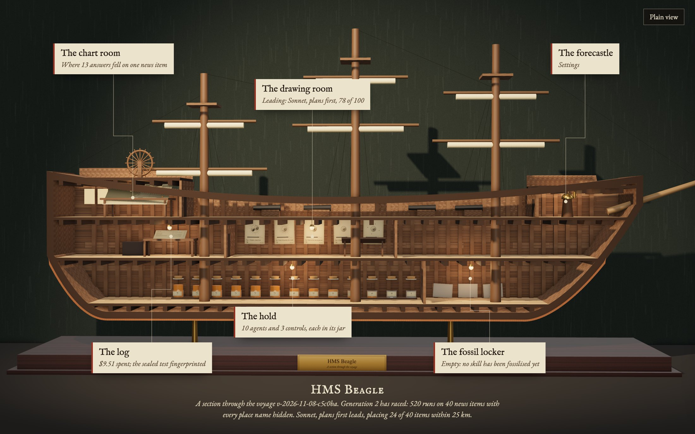
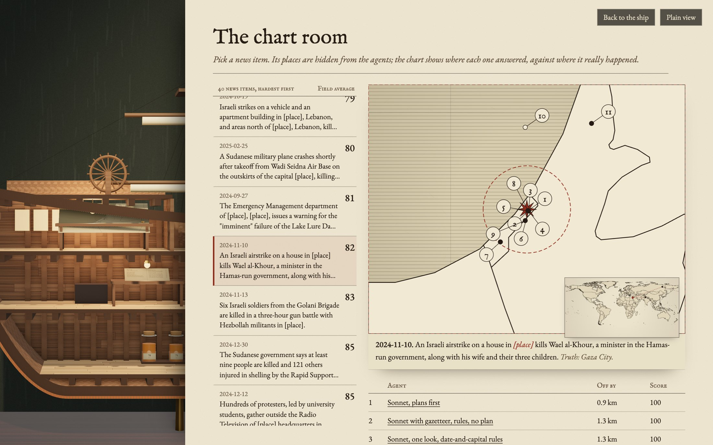
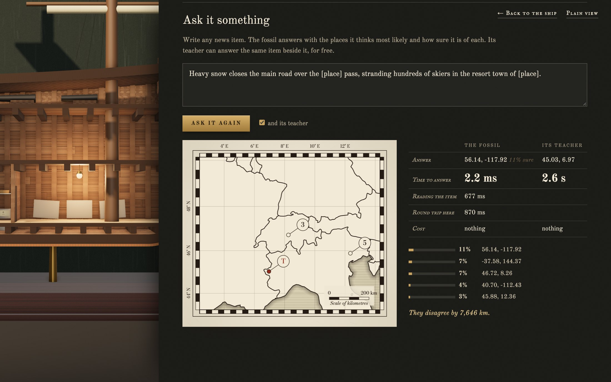
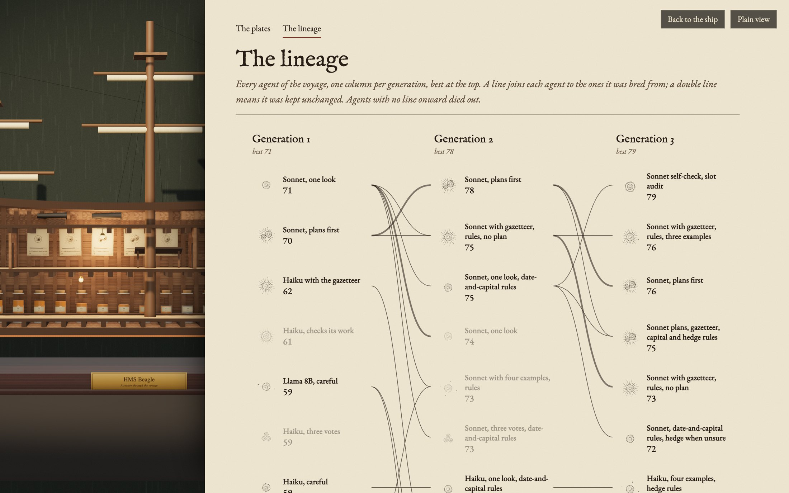

<div align="center">



&nbsp;


<br/>


<a href="LICENSE"></a>
<br/>


<br/>


&nbsp;

<a href="#what-it-does"><kbd> &nbsp; <strong>What it does</strong> &nbsp; </kbd></a> &nbsp;
<a href="#the-voyage"><kbd> &nbsp; <strong>The voyage</strong> &nbsp; </kbd></a> &nbsp;
<a href="#the-ship"><kbd> &nbsp; <strong>The ship</strong> &nbsp; </kbd></a> &nbsp;
<a href="#why-you-can-trust-the-numbers"><kbd> &nbsp; <strong>Why you can trust the numbers</strong> &nbsp; </kbd></a> &nbsp;
<a href="#run-it"><kbd> &nbsp; <strong>Run it</strong> &nbsp; </kbd></a>

</div>

<br />

Beagle breeds AI agents. You give it a task and a way to grade it. It races a population of agent designs on real examples, and a designer agent studies the winners and the ways they failed and writes the next generation. When an agent is good enough, Beagle presses its skill into a small neural network trained on your Mac, which answers in milliseconds for nothing.

All of it happens inside a museum section model of HMS Beagle, the ship Darwin sailed on. Each room of the ship is one part of the work.

## What it does

**The arena.** The first task is hard on purpose: here is a real news item from Wikipedia's Current Events, with every place it names replaced by `[place]`. Where on Earth did it happen? Answers within 25 km get full marks, falling to nothing at 2,500 km. The arena holds 6,978 items from 2023 to 2025, with their true places from Wikidata: 4,383 to learn from, 1,873 to race on, and 722 sealed away until the end. Another 5,764 unlabelled items are kept for training fossils.

**Agents.** An agent is written down as data: which model runs it (Claude, or a model running locally in Ollama), what it is told, whether it may look places up in an offline gazetteer of 171,811 towns, 3,782 regions and 246 countries, how its steps are wired (answer once, plan first, check its own answer, or vote), and how many worked examples it is shown.

**Races.** Every agent in a generation answers the same items, with three controls beside them: a random point, the gazetteer with no model, and one plain question to Claude. Beagle runs its own loop for every model call, so every step, tool call, cost and second is on record.

**Breeding.** The designer (Claude Opus) reads each agent's score and design, and the actual mistakes the best agents made on practice items. It never sees a race item or a sealed one. Then it writes children: one or two changes from a parent, or a cross of two, each with the reason.

**Fossils.** The winner answers hundreds of unlabelled items. A local embedding model turns each item into numbers, and MLX trains a two-layer network to answer the way the winner did. The fossil is then judged on the same race items as everyone else, and reported straight, including when it is worse.

## The voyage

Everything here is from one real voyage, `v-2026-11-08-c5c0ba`: three generations raced on 2026-11-08 for $13.88 of Claude usage. Every agent and control in a generation answered the same 40 news items.

**Generation one** raced twelve hand-written agents. It hit its $5 cap with three items left, so it is scored on the 37 items every entrant finished. Sonnet answering in one go led at 71, placing 17 of 37 items within 25 km. A free local Llama 8B scored 59, level with most of the Haiku designs. Llama with the gazetteer answered only 7 items in 37, and the 1.7B Qwen models placed nothing within 25 km.

**The controls told the first story.** One plain question to Claude scored 44, because with the places hidden, Haiku often refuses to guess: *"I cannot reliably identify the specific location of this incident... providing coordinates would risk giving you inaccurate information."* The winning agents are told to reason from every clue that is left (the people, the groups, the institutions, the date) and to commit.

**Generations two and three** were written by the designer. Its reasons point at real misses, quoted here:

> The best agent missed by 3,500 km on the Jakarta item because it read 'accuses [place]' as Papua rather than the government. It missed by 9,400 km on the Swiss landslides by defaulting to China, and by 1,000 km on the Philippine ambush by guessing Mindanao.

The voyage's best is generation three's *Sonnet self-check, slot audit* at 79 (range 69 to 87), bred to catch exactly those traps with a second look. But the plain result is a plateau, not a climb. *Sonnet, plans first* was kept unchanged through all three generations and scored 70, then 78, then 76 on the same design. With 40 items, a score moves about 8 points from noise alone, so no bred child has yet clearly beaten its parent. Beagle shows the ranges, and only calls a win when they separate. What did move was the field: by generation three, six Sonnet designs sat between 72 and 79, where generation one had two Sonnets at 70 and 71.

**The fossil.** Llama 8B, careful answered 800 unlabelled items for free. Those answers, plus 4,383 practice items with their true places, trained a 2.4 MB network in 3.3 seconds. It answers in 0.18 ms (16 ms with the embedding) and costs nothing to run. It scores 34 against its teacher's 59, so it does not stand in for it, and the fossil locker says so.

**Two earlier voyages were withdrawn,** and the log keeps them with the reason. The first used an easier arena that named the places, and every agent scored near the top. The second, $21.92 of runs, had a fault the final review found: agents written to see no worked examples were shown eight. Its results described agents that did not match their designs, so they were thrown out and the voyage above was run from scratch.



## The ship

The home screen is the model. Point at a room, or its label, and the camera goes in and a folio opens beside it.

- **The chart room** is where the work is read: pick any news item and see where every agent answered, against where it really happened.
- **The drawing room** draws every agent as an engraved organism. Its body is how its steps are wired, spines mean it may use the gazetteer, seeds are worked examples, and the bar beneath is its score with the fine line of its likely range. The lineage page draws the whole voyage as a family tree in ink, with the designer's reason for every child.
- **The hold** keeps a jar per agent, filled to its score, and a plain ledger of the field.
- **The log** holds the proof (below).
- **The fossil locker** shows each fossil pressed into stone: its training curve is cut as strata, and the pass that was kept is marked.
- **The forecastle** is Settings: caps, models, evolution, plain or lab view.

Every number on every screen comes from the local API, and a browser test checks 25 things against it. Plain view explains every number in words; lab view adds cost, time, ranks and raw answers. Every term of art has its meaning a hover away.





## Why you can trust the numbers

- **The sealed test is fingerprinted before anything runs.** Its hash is printed when a voyage starts and checked again before the sealed items are ever used. Every voyage on an arena shares the same sealed set, so once it has been scored, later voyages on that arena are less independent of it. None of the voyages here has opened it yet.
- **The designer never sees race or sealed items,** and a test checks that no race or sealed text reaches its prompt.
- **Controls see exactly what agents see.** Getting this wrong once made the controls look far stronger than they are. The fix has a test, and the wrong runs were thrown away and redone.
- **Ranges, not just scores.** Every score has a 95% bootstrap interval, and Beagle only calls one agent better than another when the ranges separate.
- **Re-grade it yourself.** `beagle export` writes a voyage as one file, and `beagle regrade` re-scores every answer from it with no model calls. On this voyage, every recorded score matched. A run whose item is missing from the file is counted as a mismatch, never as a pass.
- **Every call paid for is in the ledger,** including runs that were later thrown away. A spend cap holds per generation and per voyage, and one race per generation can run at a time. (Before that rule, a second process paid for the same runs twice. The log shows the money.)
- **A usage limit is not a fault.** When Claude's limit is hit, the race stops, keeps every finished run, and the same command picks up where it left off.
- **Memorisation is reported.** In the withdrawn second voyage, two answers matched Wikidata's coordinate for southern Lebanon to six decimals. The run's full record shows no access to it: Sonnet recalled it from Wikipedia.

## Run it

You need a Mac with Apple silicon, Node 22.13 or newer, Claude Code (signed in), and [Ollama](https://ollama.com).

```sh
git clone https://github.com/AllStreets/beagle && cd beagle
npm install && npm link
ollama pull llama3.1:8b && ollama pull qwen3:1.7b && ollama pull nomic-embed-text
beagle arena build geotag            # about 15 minutes, all cached
beagle voyage start geotag --race-tasks 40
beagle race <voyage>                 # generation one
beagle evolve <voyage> --generations 2
npx tsx src/server.ts                # the ship, on http://127.0.0.1:4750
```

Fossils need MLX in a native Python: see [trainer/README.md](trainer/README.md). Then `beagle teach <voyage> <agent>` and `beagle fossilise <voyage> <agent> --with-breeding`.

Claude calls go through your own Claude Code, with your settings, plugins and MCP servers switched off. On a Claude plan they count against your usage, not a bill; the caps are in Settings.

## Tests

```sh
npm test                  # 74 engine tests: arena, runner, races, caps, locks, designer, fossils, API
npx tsx tools/ui-test.ts  # 25 checks of the ship and its rooms against the live API
```

## Data

Wikipedia text (CC BY-SA 4.0), Wikidata (CC0), GeoNames (CC BY 4.0), Natural Earth coastlines via world-atlas (public domain).

## License

MIT
